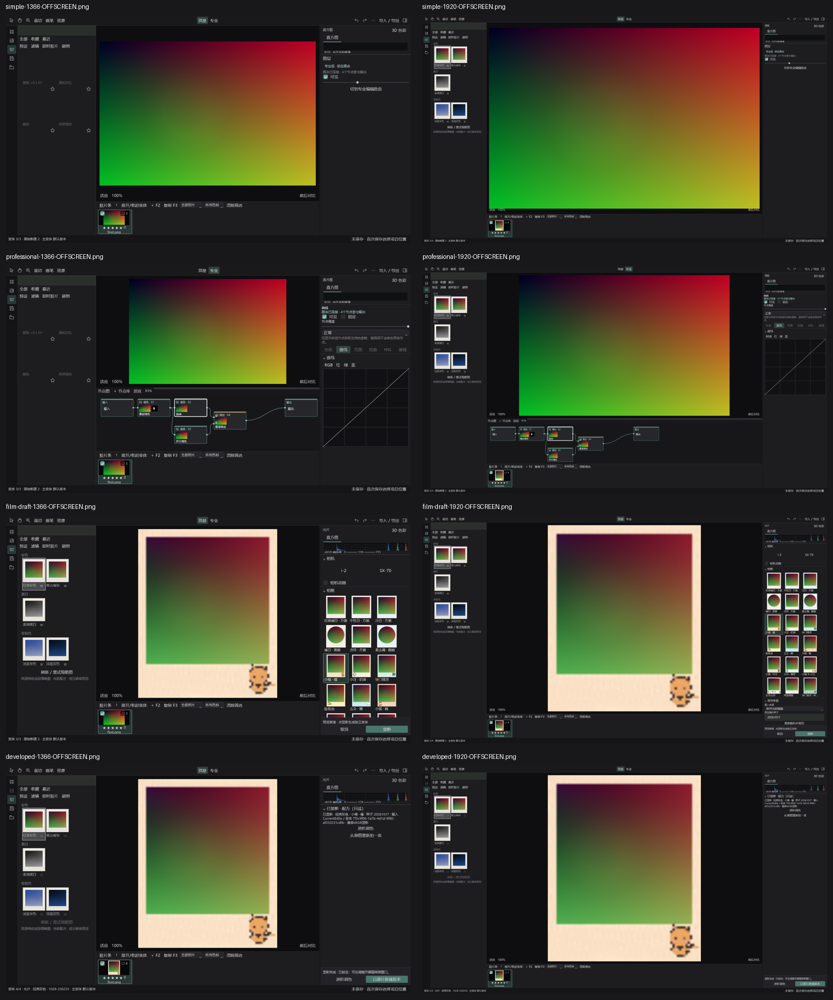

# 家庭 R5.4 接续结果 — PARTIAL，不能发行
日期：2026-10-28（America/Los_Angeles）。接续“你好 (2)”的已提交实现和未提交交付资料。

## 身份与范围
- 工作树：N:/pixart/guangjing-r54-darkroom-20261028；分支 home/r54-darkroom-20261028。
- 已 fetch 并核对 company/r53-color-tools-film-20261028 = 73ac0b2483d5c09cd4860bd8cf47c955e18d128d；研究分支 = 0146c8d3430df3c3481ceb874d13fa00186a18c7。
- 本包编译产品 SHA：14bbb60debdd0b176490adb24747023de59b1dbf。后续提交仅交接文档、启动/交付脚本及证据，产品源保持。
- 没有 reset/clean/stash/rebase 旧树、合 main、强推或整合研究分支；没有 Browser/WebView/CDP/ComputerUse、自动网页/资源管理器。

## 实装与本次补修
前会话 99e1c9ed/2356d440 已实现并在本轮重新构建验证：
1. 图结果按下游消费者计数释放；共享祖先每次渲染只计算一次。仅经白名单验证的逐点工具在 >2MP 时采用 64 行、最多4并行的 halo0 条带，蒙版使用完整源坐标。细节/邻域工具不冒用 halo0。不降低最终尺寸/位深/跳节点。
2. 节点卡为各节点自身输出缩略、已有蒙版缩略、类型图标、顶3DIP标签、选中白边、锁定/旁路状态；源与输出端点不冒充中间输出。有界生产缩略路径和换图/变体/路由失效保护。
3. 专业参数按所选节点显示适用分区，不显示整份长表单；未实现工具禁用。锁定节点反映可编辑性。
4. 原创相框卡使用当前照片+每框实际生产缩略，换图取消旧结果。已显影相纸选择器禁用后保持深色。
本次实际查看离屏图发现“混合”卡与“输出”重叠，14bbb60d 补修新增并行分支初始布局：挪开可移动下游并避免与已有卡重叠；锁定卡位置不动，图边/顺序/数学不变。增加默认卡不重叠断言，新图已查看。

## 四状态实际查看
生产程序集绑定的简易、专业、即时胶片草稿、已显影，1366/1920有效DIP共8图，另有真实 MainWindow 离屏6图和窄窗等效DIP布局结果。

节点区位于照片与胶片条之间；1366初次22DIP折叠、用户展开后保留已测试。简易复杂图仍是保守整栈专业组，强度/显隐/切回专业不破坏图；没有声称实现精确子图分组。
**以上均为 OFFSCREEN 合成输入生产控件，不是桌面实机鼠标/DPI。** 本轮重新读图并修复重叠，不能替代与缺失定稿的逐项验收。

## 20MP 实测（本轮重跑，非引用公司结果）
授权既有 Canon TNAN8886.CR3，hash与测试冻结值一致；5496×3670=20,170,320像素，解码675.734ms。
| 图 | 800px代理首帧ms | 原尺寸精细渲染ms | TIFF16编码+结构校验ms | 采样峰值工作集bytes | 账本峰值bytes | 结束账本 |
|---|---:|---:|---:|---:|---:|---:|
| serial (10节点) | 848.997 | 11324.235 | 490.623 | 1861980160 | 309578688 | 0 |
| shared (4节点) | 310.140 | 3716.382 | 380.424 | 1838612480 | 326462400 | 0 |
| mix-chain (16节点) | 1122.225 | 13533.085 | 400.710 | 2432950272 | 343346112 | 0 |

- 三者原尺寸精细渲染和16位TIFF均成功；表中的编码时间**不含前一列图渲染**，不是完整导出命令耗时。首帧是测试代理通路，不是鼠标到屏幕延迟。
- 基线 serial/mix-chain 曾预算拒绝（保留 LARGE_BASELINE.json），shared 基线精细7622.301ms。两轮负载/热身不同，不能把当前时长当严格性能提升比。
- 当前工作集峰值约1.71–2.27GiB，账本约295–327MiB；账本不是进程硬内存上限，不能宣称已彻底消除内存高峰。工作集为10ms轮询，不是系统级分配追踪。
- 每带保留节点缓冲峰值2/3/4；proxy effect调用10/3/11验证共享祖先不重复。条带总调用数含各带，不能误当重复全图计算。
- 三个源位置的浮点采样精确一致，另有2.08MP蒙版+组强度源坐标边界点对照及小图全像素参考；不能把三点验证称20MP全像素外部参考。
- 连续取消/注入异常/重复渲染账本归零，借用源不被销毁；换图/变体/关闭缩略任务失效已测。输出缺输入会明确提示原图，节点草稿保留。

## 测试与身份
- Core受影响34通过；WPF受影响18通过；独立进程建项目1、另一进程重开导出1、完整宿主离屏1、20MP实测1：共56通过，0失败。
- 外部固定 darktable/RawTherapee 标量参考1项 NOT_RUN：没有 independently executed reference JSON，未自造数据补“通过”。TRX汇总按每条 outcome 统计，不能仅靠 VSTest exit=0 或Counters.notExecuted=0。
- 自包含 win-x64 / WholeAppDiagnosticBuild=true / PhotographerTrialBuild=false。29项发布到测试宿主DLL绑定重新hash比对，全部相同。保留完整模块/策划15，旧教程停用；不是聚焦试用壳。
- OS启动/CMD启动与关闭另行记录，只证明空应用进程和窗口，不证明保存重启真实鼠标业务闭环。

## 相框与宝丽来边界
- 原创12框V1 nearest保持冻结。FRAME_QUALITY.json逐框检查透明/部分alpha/水平边缘，并与premultiplied bilinear做128px差异诊断；不是画质真值，不是发布重采样升级。未暗改配方/资源hash/窗口/照片强度不染框合同。
- 已读 research@0146c8d3 的审计、集成文档和两profile，只读保留；现代彩色/黑白仍是风格近似，实测模型0。未注册产品，不改名i-2/SX-70实测，不叠加旧tone，不写“已接入”。
- UI5.4原包 SHA256 88dfcf82b5139bed2fdf06c7271063163b59d372a887d0b362070ec7e3be4d26 的本机实体仍未找到，无法现场重读第9章和v2原图。公司读取记录不是本机读取证据。只检查既有项目设计目录和明确下载位置，没有扫描无关照片目录、没有执行notebook。

## 剩余，不算完成
1. 需补UI5.4原始设计包或其第9章+v2草图，完成定稿逐项视觉核验后才进入候选接入；已有R5.3 HTML资料不缺。
2. 真实鼠标拖线/焦点/保存重启/出版，物理125/150%DPI、多屏ACM/HDR仍NOT_RUN。
3. 精确子图专业组、多剧照共享/2–4变体对比尚未做；AI主体/天空/皮肤、修复/仿制、透明像素、扭曲及纹理笔刷维持禁用。
4. 对含邻域/非白名单节点的大图采用原路径，本次20MP压力覆盖的是10节点逐点串行、共享祖先和连续5混合，不泛化为任意64节点图的内存保证。
5. 宝丽来需显式新tone版本、完整模型冻结/hash、跨缩略/预览/显影/保存/独立重开/PNG16-TIFF16-JPEG一致性后才能标接入。真实配对拟合未完成；不要求购买/补拍36张。

## 交付入口
完整新包：N:/pixart/Guangjing-R54-Home-20261028/Guangjing-R54-Home-Resume-Diagnostic-win-x64
默认CMD每次创建新隔离数据根；持久复测同一根请用PS1 -DataRoot。包含合成项目准备脚本，不含私人原片/RAW/研究二进制/UserData。最终ZIP身份见 ZIP_IDENTITY.json；最终普通推送读回见 PUSH_READBACK.json。
