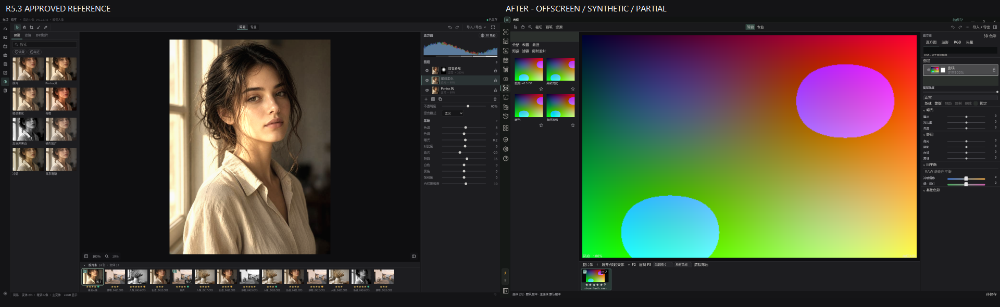
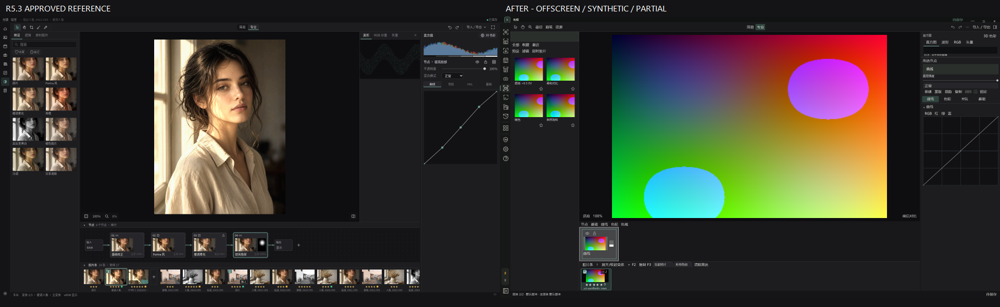
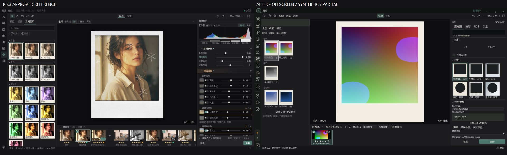
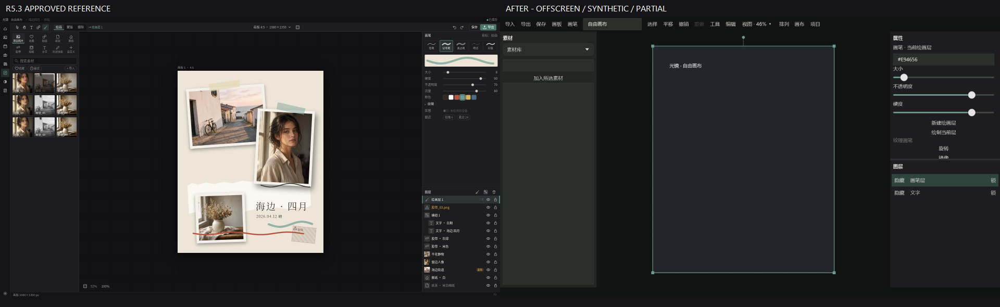

# 光镜 R5.3 界面纠偏接续 — PARTIAL，不能发行
日期：2026-10-28（Asia/Shanghai）。**本轮恢复了部分真实界面和关键交互，但尚未达到用户定稿的视觉完成标准。**

## 先看定稿与实现对照
下列右图均为 **OFFSCREEN / 合成输入 / 生产WPF控件**，不是实机截图；左图为已确认原版。

### 简易暗室

### 专业暗室

### 即时胶片（1366）

### 自由画布

## 已修的可见差异
- 完整宿主暗室导航收为 **40 DIP**；页面重复AppRail隐藏，所有全局导航命令保留。标题栏24 DIP / 工作工具栏34 DIP；去重复菜单、第二底状态和遮挡参数入口的关闭叠层。次级操作进菜单，保留退出和保存失败重试；修原生标题拖拽高度以免吞掉工具栏点击。
- 修正小于1440直接隐藏右栏：以页面实际客户端DIP分配，窄窗有40DIP参数轨，可点击恢复，足够空间停靠、不足空间抽屉；布局重算不抹掉明确展开。资源抽屉保留。即时胶片右栏全高、参数独立滚动、取消/显影贴底。
- 简易按直方图→图层→强度/混合→基础调整组织；38DIP图层行接真实前序栈缩略、显隐、蒙版和锁。预设改真实当前照片效果卡，不再纯文字列表；不支持的RAW同域预设缩略明确禁用。
- 专业使用共享数据/历史和串行节点；右栏所选节点、曲线/色轮/HSL/基础分类；节点具备显隐、锁及蒙版入口。其他真实工具从菜单可达，不删除能力解决拥挤。
- 节点区和胶片条独立折叠，均保留22DIP展开条。胶片条缩略高度纠正，避免92DIP内容内裁掉名称。
- 即时胶片左唯一相纸、右相机/相框/常用/瑕疵/高级；移除左RenderFilmFrames调用。三列容器、搜索/收藏/最近/分组沿用真实5响应。240px缩略调用同冻结输入/配方和生产渲染器，换配方取消、迟到结果拒绝；自动加载和重试保留。RAW SceneExposure输入通过既有输出渲染形成画廊专用有界输入，原RAW配方/变体不改变。
- 修完整宿主才暴露的XAML资源缺失、保存后胶片预览回原图、右相纸标题重新出现；已显影底部切换进阶调色/原片新建，旧变体保留。
- 自由画布复用原CanvasEditor/渲染器：左素材缩略、中画板、右上属性/右下图层可调分隔；画笔参数移入属性区，不再另开画笔/图层窗口。显式保存入口保留。

## 尚未完成，不能写成UI已完成
1. **即时胶片仍只有5组现有真实响应，不是定稿完整相纸数量**；不伪造16张不同响应卡。相纸卡总体数量、选中样式/分组细节仍不一致。
2. 相机实拍图来源/分发权未完整确认，当前仍文字相机选择；原型官方相框图注明仅参考，不能仅凭shippable=true当作授权。**12款原创框明确允许随产品发布，但尚未接统一预览/导出，是实施缺口而非版权阻断**；当前仅6程序框，远未达到纹理相框定稿。联名仍不打包。详见DESIGN_RESOURCE_RIGHTS.json。
3. 参数行密度、预设卡数量、资源标签/搜索先后、照片条选择态等仍与定稿不同；简易仍按基础分组，并非精确最终十行。即时胶片完整宿主直方图在草稿呈现后可无分析，不标作完成。
4. 3D检查器仍沿用既有停靠/专注行为，尚非定稿默认左侧浮窗。
5. 自由画布只完成外壳归位和现有操作重组，十类素材、完整画笔预设、纹理、图层样式和视觉精修未完成；150%有效DIP时属性独立滚动，底部参数需滚动访问。
6. **真实鼠标/键盘、宿主真实125%/150%设备DPI、多屏/ACM/HDR验收 NOT_RUN**。遵守ComputerUse/Browser/WebView/CDP禁用，无原生截图冒充。

## 实际启动包与产品身份
- 完整Windows x64自包含诊断ZIP：E:/Kitao-Deliveries/r53-ui-correction-20261028/Guangjing-R53-UI-Correction-Diagnostic-win-x64.zip
- CMD：E:/Kitao-Deliveries/r53-ui-correction-20261028/Guangjing-R53-UI-Correction-Diagnostic-win-x64/Start-Guangjing-Diagnostic.cmd
- 产品源码SHA：**ae6e83b2b7368d25f64c064b120b2e8a3d9aa965**（首个UI修复ecf5efc1；RAW画廊兼容补丁ae6e83b2）。
- 分支：company/r53-color-tools-film-20261028，起点4e9dfc4a9b65ab78379c1fa2bf1ff514742a0bec。
- WholeAppDiagnosticBuild=true / PhotographerTrialBuild=false；全部模块/策划15板块架构保留。非Setup、旧教程继续退役；默认研究门禁不改变。
- 文件293个 / 188873283 bytes；ZIP 76960053 bytes；逐项ZIP解压流哈希与发布文件一致，无用户数据/数据库/RAW/测试宿主/Setup。
- ZIP SHA256：**cf969630693f96face770959edbb366df25aaaeaf2789e22bb134e2dd9b47f84**。
- 每次CMD创建包旁新UserData隔离根，不访问日常资料、不修改执行策略。构建来源写入程序集，真实EXE启动日志读回产品SHA一致；OS正常启动/关闭通过，不等实机交互。

## 适量相关回归（绑定最终发布7个项目DLL）
最终 **36个唯一测试PASS / 0 FAIL / 0 NOT_RUN**。两项独立重开在创建进程有意NOT_RUN，然后专门新进程PASS，按唯一测试去重统计；历史探索失败/中止日志保留但不混入最终成绩。
- 暗室保存重开/共享模式/原片只读/锁/关闭冲突：11。
- 相纸命名/真实预览/历史/比较：2；RAW画廊保场景/变体：1。
- 显影/只读/取消/窗口调色/原图保持：5。
- 自有画布源/丢失恢复/工程隔离：5。
- 透明画布/alpha/ICC/撤销/普通画笔/保存/PNG导出及独立重开：3。
- 宽域当前编辑→胶片输入→保存/发布导出及独立重开：2（已有功能回归，未新开发算法）。
- 完整模块壳/关闭分支/诊断隔离：3。
- 四屏DIP布局/独立折叠/画布分区/完整宿主40DIP唯一轨：4。

测试详情：TEST_SUMMARY.json；发布绑定PUBLISHED_TEST_BINDING.json；原始FINAL TRX和日志：E:/Kitao-Deliveries/r53-ui-correction-20261028/FINAL_TEST_LOGS.zip。未重跑无关算法全套，0失败不证明全部功能或视觉通过。

## 保全与下一步
其他52个工作树HEAD、dirty清单及原脏文件SHA256均未变，PRESERVE_AFTER.json逐项记录；当前产品提交时工作树干净，未reset/stash/clean/merge/rebase/force-push。
下一步只沿本定稿优先补：可分发原创相框全链/相机资源核验、完整相纸卡与布局精修、实时直方图、3D左浮窗、自由画布定稿细节；不把现有处理能力或自动测试当作视觉完成。
普通推送/读回见PUSH_READBACK.json（提交证据后生成）。
