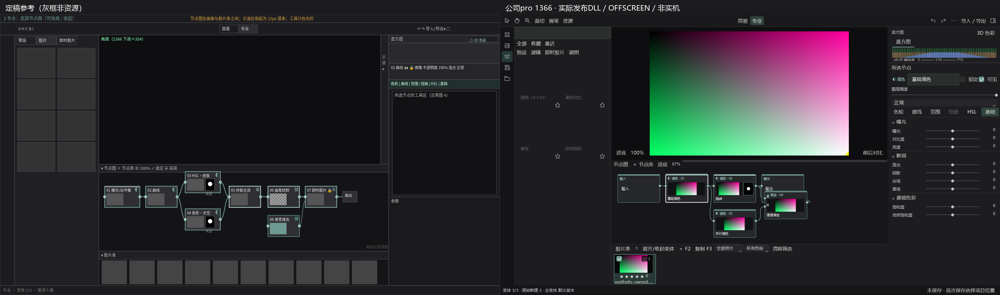
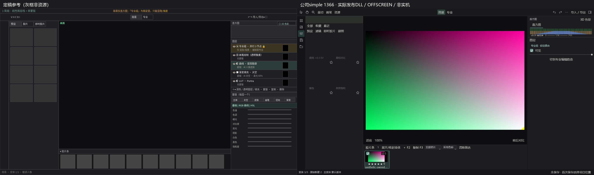
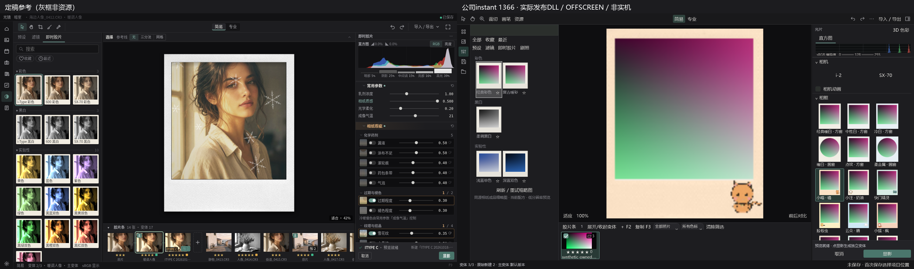
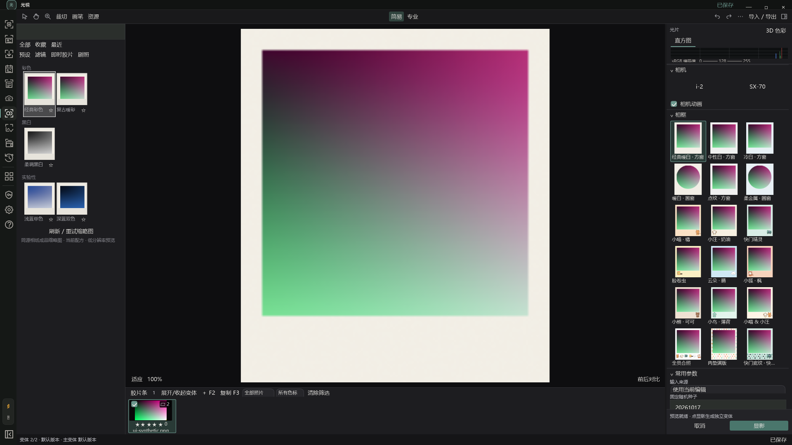
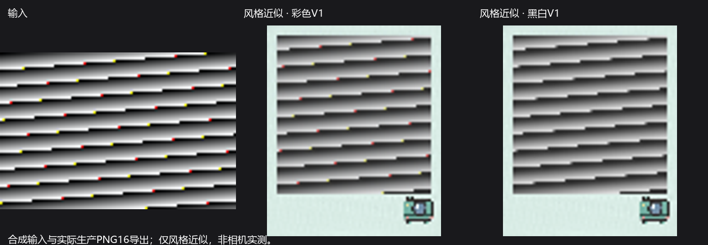

# 公司R5.4界面与节点稳定性收尾
日期：2026-10-29（Europe/Berlin）。**A/B本轮自动交付集合通过；完整应用诊断状态仍PARTIAL，不能发行。**

## 家庭成果定位
执行fetch --all，核对origin/source-private完整refs/远端heads；二者指向同一个private源码仓库。相关本机clone的remote也已查，额外pixel-tart-handoff仅旧main40b95738…和2026-08-18状态/收据，没有R54。
结论：**家庭成果未在可访问远端发现**。未假定家庭任务完成；未访问N盘、未扫描无关私人目录。本批开始/A-B后/封包前多次读回home/*r54*均空，原company分支仍73ac0b2483d5c09cd4860bd8cf47c955e18d128d。原产品06e33、宝丽来研究0146c8d3430df3c3481ceb874d13fa00186a18c7保持。
新公司分支`company/r54-closure-20261029`、独立树`E:/Kitao-Worktrees/r54-closure-20261029`从上述公司HEAD继续；旧树未reset/clean/stash/rebase，不合main、不强推、不整分支合研究。

## A 可见界面实际完成
- 节点卡真实生产输出缩略、单蒙版实际灰阶缩略；调色/混合类型标识，顶部3px同系标签（写入同历史）、选中白边。无可用输出只写等待，不制造灰块照片。
- 右栏按所选节点类型呈现对应工具。曲线只出现曲线，白平衡只白平衡，影调曝光/基础色彩按真实node合同组合，不把所有长表单叠满。六工具入口保留，尚未实现扭曲禁用；切页选择/新增对应真实节点，不暗改其他节点。
- 窄窗参数入口/节点22DIP折叠/高度记忆/fit与照片条恢复沿现有合同；节点图仍在照片与胶片条之间，右栏备选未采用。
- 简易复杂图仍保守“专业组”，显隐/强度与专业切换不修改边、共享同history/保存。细分复杂子图不在本批声称完成。
- 原创相框卡显示**当前成品照片窗口+真实材质**，共用CandidateRenderSession而非空黑窗/CSS；实际18框条目（含既有6程序框和12原创），并无新增相纸响应凑数量。最后消费者/迟到/取消与目标版本保护，完整App宿主暴露的卡片刷新时序已修并实际等待18卡读回。
- 四状态（简易/专业/即时胶片草稿/已显影）1920/1366逐图对照并查看；其余外壳/即时胶片/变体/3D/拼贴/策划继续既有HTML。灰框不是正式资源。

### 专业1366定稿与生产控件

### 简易1366定稿与生产控件

### 即时胶片当前照片框卡

### 完整宿主最终读回

全部为**实际发布程序集绑定 / OFFSCREEN / 生产控件 / 合成输入**，不是桌面或鼠标/DPI验收。

## B 大图性能与所有权实测
样本为现有用户授权CompanyRAW `TNAN8886.CR3`，SHA256 B7D358517DB0CD5B5C54215AA089A5A30C79234AEF50E9381931128493E33401，既有PV4 full display master **5496×3670 / 20,170,320像素 / encoded sRGB float32**。source本身/largeRGB/TIFF均仅本地留存，不进Git/产品。另一个现有DSC09916.ARW被LibRaw OpenFile拒绝，未回退，也不算已覆盖的第二成功相机。

|图形|旧1600实际生产预览峰值WS|新实际生产预览峰值WS|新实际预览耗时|旧full graph计算|新full graph计算 / 峰值WS|
|---|---:|---:|---:|---|---|
|8节点串行|2.366GB|0.554GB|11.70s|全节点预算拒绝|24.15s / 1.002GB|
|共享祖先双分支|2.337GB|0.559GB|10.71s|全节点预算拒绝|24.54s / 1.245GB|
|两个合流混合|2.338GB|0.563GB|10.40s|全节点预算拒绝|24.60s / 1.487GB|

- full是完整float计算，不假称旧应用所有导出都失败：**旧有rowband可完成**，本批保留原baseline程序集运行它作为20MP像素oracle；新full输出hash与旧rowband逐位相等。原/新production-preview hash也逐位相等。
- 最终发布Core再次验证双合流：生产预览约10.4s/0.56GB；**实际TIFF16编码+回读约25.80s / 1.490GB，full5496×3670，RGB结果hash一致**。最终RGBA/编码本身额外工作集不是账本上限。
- 图按最后下游消费者释放，shared ancestor只算一次；输入借用，输出转caller，取消/异常安全。图局部精确长度RGB backing复用，free但仍retained的pool slot也计Work。scope结束释放free/未认领临时，escaped result在Dispose释放。工作量不再按N节点全部预留；上层rowband按峰值live图推导。
- 新full ledger峰值串行0.484GB/分支0.726GB/双合流0.968GB；每次完成后0。生产preview在每worker复用行带，ledger总峰约7.1/9.5/11.9MB。**账本不代表完整进程/CLR/native实际内存**，WS是5ms采样，不是硬上限。
- 20MP取消2次+完整重复2次ledger均回0；同大图保存后独立进程重开full结果hash一致。另有mask/bypass/group/consumer/异常/重复的all-retained小型oracle，不拿小图替代上表。
- 未降低最终分辨率/float/16bit导出，未换Display/WB/混合公式。性能仍约24–26s/full，不能称即时大图；仅一张成功RAW性能样本，不作多机大图覆盖结论。

## 后置宝丽来可选组件
A/B门禁通过后按需读取研究0146c8d3，仅选择导入两款第一方profile JSON和显式算法，不整分支覆盖：
- `polaroid-modern-color-style-smooth-1`，hash `87677b36a62c78f1001ad206c16e8f4c5f69b0095e6fd14ef5a02be9c0dddeaf`
- `polaroid-modern-bw-style-smooth-1`，hash `e931eb989fad6d5f83d87dc4dc5fdd140750183cb2cd10b029ebf71579068e2d`

**只能称风格近似，非i-2/SX-70实测拟合。** 在对应现代i-Type/600基础相纸右栏选择，旧版默认；不支持的世代/相纸不强加，不造相机色偏。新Candidate内部AlgorithmVersion4防旧读取器默套旧tone，外层仍复用原V3完整链。
配方嵌完整模型JSON/版本/模型SHA/数据manifestSHA；哈希/版本不匹配明确失败，不调用最新同名资源替换。tone阶段直接替换，不重复旧CandidateTone/Womb或旧色偏/精确温度外观；旧项目没有新组件字段仍原色彩结果。与不兼容旧tone控制联动禁用，不让滑块假生效。
8192固定点对产品与原Python候选解析误差max≤2.78e-16；这只是复现误差，不是真实配对照片误差。两候选的gallery→preview→develop→保存重开/独立testhost→PNG16/TIFF16/JPEG同链验证；相框独立，不受照片amount意外染色。

没有新测量数据、没有光谱真实模拟声称。16bit/float配对拟合工具入口仍后续；补拍清单仅研究建议，未要求现在采购或拍36张。

## 实际验证与边界
最终绑定发布包7项目DLL、Core与性能bench DLL byte hash一致后，受影响集合：
- Core **30 PASS / 0 FAIL / 0 SKIP**；含资源/异常/共享祖先/新旧模型/解析与LUT区分/蒙版与历史路径。
- WPF **13 PASS / 0 FAIL**；含四状态宽窄、相框实际照片卡、12原创逐一PNG/代表TIFF/JPEG、模式与专业组、保存/导出。
- 独立进程graph+新模型重开 **2 PASS**；完整App宿主卡片读回 **1 PASS**。
- 合计唯一通过 **46**（不是全量全产品suite），TRX原始结果在test-results/。包实际EXE启动/正常WM_CLOSE exit0，日志产品SHA一致。
- 早期测试曾发现并行测试账本干扰（资源类需DoNotParallelize）、一处宿主卡刷新时序；均保留本地失败记录并重跑最终绑定集合。一次helper使用PowerShell只读$Host造成URI错误，已收集失败helper到交付根、不覆盖用户文件，非产品最终失败。
- **ComputerUse/Browser/WebView/CDP未用于本机验收；真实鼠标/125/150%设备DPI/多屏ACM/HDR NOT_RUN**。离屏/自动/OS启动不互代；完整应用全量测试NOT_RUN。

## 明确剩余
- 大图只有上述单一成功20MP样本；Sony未覆盖、X-Trans/其他超大图仍需原准入，不能泛化。
- 简易专业组仍整复杂图保守呈现，细分子图与普通线性层并存未做；缺失/未连接节点可能等待输出，不冒充渲染。
- 灰盒草图功能范围之外的AI蒙版、修复仿制、外部/填充/透明引擎、扭曲和纹理笔刷继续后续；本轮没用禁用菜单刷实现数量。复杂图旧预设组合缩略适配仍禁用。
- 剧照共享2–4完整工作流、其他前报告视觉余项未扩大实现。相框nearest资源重采样仍继承，未宣称最佳大图画质。
- 局部控件图标密度与最终美术仍可精修，原生指针/设备DPI尚未验收，因此整体PARTIAL/诊断，不叫R5.4最终发行版。

## 完整应用交付
- **产品源码SHA `674aaa1887a03173e439d593e505a95d26a22139`**；包含fc5899a6主实现+674aaa18完整宿主卡刷新补丁。
- 分支`company/r54-closure-20261029`；文档HEAD另记推送收据，不当产品SHA。
- 完整包`E:/Kitao-Deliveries/r54-closure-20261029/Guangjing-R54-Closure-Diagnostic-win-x64.zip`
- CMD`E:/Kitao-Deliveries/r54-closure-20261029/Guangjing-R54-Closure-Diagnostic-win-x64/Start-Guangjing-Diagnostic.cmd`
- WholeAppDiagnosticBuild=true / PhotographerTrialBuild=false，完整旧包项目模块集合核对保留、策划15架构不删、旧教程停用。每次CMD独立UserData；不Setup、不含测试数据/私照/大图/数据库/参考源码。
- 297文件、展开191775828 bytes；ZIP 77074652 bytes，SHA256 **`0815f2b05afe075d2ff66233fff53edf963af54b6bdbce06b13165298305cafb`**；逐项ZIP解压流hash核对PASS。
