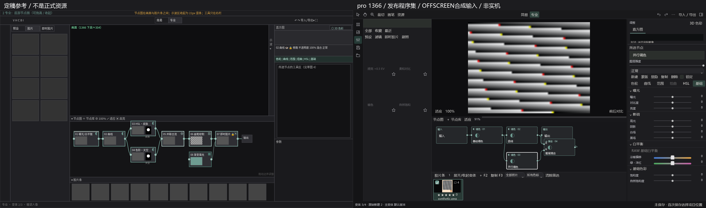
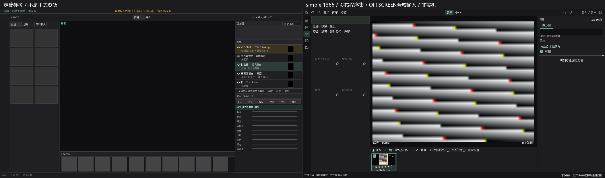
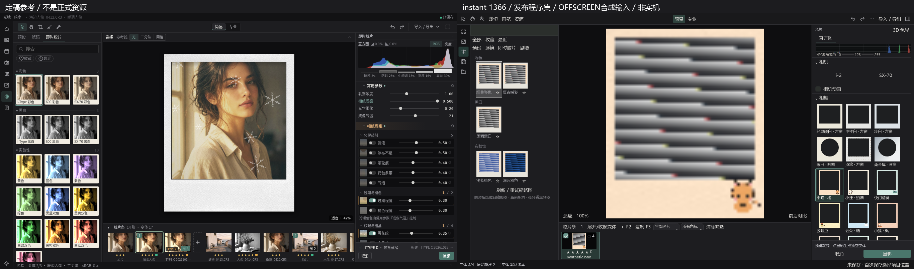
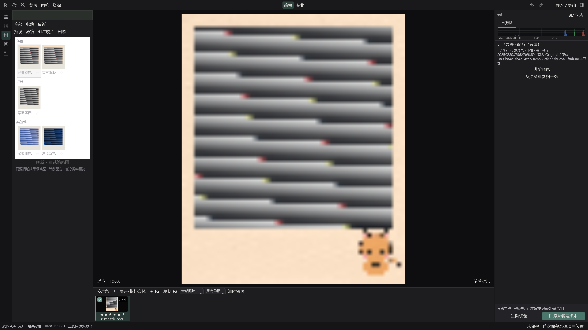

# R5.4 暗室节点系统与视觉纠偏 — PARTIAL，不能发行
日期：2026-10-28（Europe/Berlin）。沿 company/r53-color-tools-film-20261028 接续，无main合并/强推，研究分支只读保留。

## 本轮实装，不是假节点图
- **Stack schema3 + Graph1/2**：节点稳定ID、rgb/base/layer端口、边、二维布局分开；旧无图Stack2不自动重排/改变像素。新schema使旧软件显式拒绝而非忽略路由。
- 专业生产二维图位于照片与胶片条之间；平移、缩放、适应、端口连线/断开、拖节点到线串行插入、自由布局；22DIP折叠和高度/视图保存；1366默认收起，较宽展开。位置不定义渲染顺序。
- 实际Graph2并行合流：base先layer后、现有encoded sRGB调整结果混合、同mask/opacity/取消/预算；五个模式。环路、重复输入/非法端口拒绝；缺祖先输入输出原图、保留断开draft；旁路、删除、锁定语义见NODE_COMPARISON。
- 复用Editor撤销/重做/事务/保存；节点重命名/复制/显隐/锁和图更改同历史，简易复杂图保守整体“专业组”，仅显隐/强度并可切专业编辑，不写平铺栈。
- 节点库搜索/六类，调色与混合真实操作；未完成能力禁用短因。图F2重命名、照片条F2原片新建、B画笔、反斜杠对比，文本编辑不触发节点删除。右栏六工具入口，扭曲禁用；RGB曲线/HSL/基础已有工具复用。示波独立可展开，不挤右栏工具。
- **12款原创真实相框**：FRA_ORIG实际RGBA+授权说明、窗口几何；配方冻结version/ID/decoded hash，资源缺失/hash错误不回退；显影/导出共用CandidateRenderSession，照片强度不染框。
- 即时胶片左相纸、右相机/相框/参数、贴底取消/显影保留；仅5现有响应组，没有复制相纸卡造响应。
- 当前成品直方图/点云分析沿取消与迟到guard；修完整宿主切模式后隐藏直方图。3D可拖/缩放非模态专注浮窗，420DIP最小视口不塞264DIP资源栏，可返回主图。
- 剧照最小闭环：抓取Ctrl+Alt+G、最多8张嵌项目保存、当前栅格参数应用、复用图像viewport的可拖划像。不是全套共享多变体剧照系统。

## 已逐屏查看的实际结果
全部右图为**发布程序集绑定 / OFFSCREEN / 生产WPF控件 / 合成输入**，不是物理桌面截图。

### 专业节点（1366）

### 简易专业组（1366）

### 即时胶片与原创框（1366）

### 已显影状态（1920）

完整宿主独立实例化App/MainWindow另有OFFSCREEN-hosted系列。宽1920/窄1366四状态共8图，完整宿主6图；原版参考仅用于评审不当产品资源。

## 不能省略的剩余差异
1. 透明像素、修复/仿制、填充、外部反向区域、AI蒙版/扭曲未实现；禁用不是完成。没有拿灰框做正式资源或假纹理。
2. 专业组目前把整个复杂图作为一组，不是精确复杂子图分组与其他线性层并存；简易对应布局/蒙版图标/节点顶部色条/卡片及右栏密度仍未完全按稿精修。真实alpha透明图层混合也不是本版的opaque调整结果合流。
3. 节点图自由空白拖动只改布局；“空白自动生成可解释新分支”未完成，新增并行通过明确动作；复杂fork节点拖线插入有限制，避免猜测拆路由。完整单节点LUT/标签/预设菜单尚欠。
4. 剧照当前应用非多选批量；独立窗口复用viewport但没有与2–4变体共用同一个比较工作流；RAW域不同明确拒绝。框选择缩略显示真实资源，但每款还未用当前照片渲染缩略；缩放资源使用确定性nearest，非最佳插值画质批准。
5. 3D用可恢复非模态专注浮窗，不声称已完全满足所有大屏左侧停靠细节。相机实拍授权和联名资源未引入；拼贴其余十类素材/纹理笔刷等仍留既有剩余清单。
6. **原生鼠标/键盘/125–150%设备DPI、多屏ACM/HDR NOT_RUN**；ComputerUse/Browser/WebView/CDP未用于本机验收。全量全部测试未运行，受影响回归不冒充全产品验收。
7. 宝丽来UI集合仍PARTIAL，所以新颜色组件未接入。解析近黑不连续与33³LUT复现误差已分别记录；旧颜色未改、候选仍风格近似/实测0。16bit/float工具入口待独立阶段；36张仅旧研究建议、不要求立即补拍。

## 验证（绑定实际发布DLL）
- Core：**29 PASS / 0 FAIL / 1 NOT_RUN**。未运行PinnedSceneExposureScalarReferencesMatchVersionedStage需额外既有外部标量参考环境；不掩盖。
- WPF实际图/历史/保存/预览/导出/12原创框/旧胶片回归：**11 PASS / 0 FAIL**。
- 新独立testhost重开与导出：**1 PASS**（不同PID、stack与导出像素exact）。完整App宿主离屏：**1 PASS**；四状态宽窄截图：**1 PASS**。
- 合计唯一通过 **43**，原始TRX在test-results/，未执行1项单列。不是测试数量代替真实功能。
- 4,000混合固定输入同时运行Pillow12.3.0和OpenCV4.10.0固定实现，max8分别≤0.9981/0.7471，小于执行前2.1阈值；不声称测量胶片或真实色准。
- 12框逐一预览→显影→PNG验证；代表框TIFF16/PNG16/JPEG编码后尺寸/ICC/像素验证；资源hash/错误拒绝；非原生鼠标选择验收。
- OS EXE启动/WM_CLOSE正常exit0、日志产品SHA读回。此只证进程启动/关闭，不证编辑交互、DPI/画质。
- 早期探索编译/生命周期错误与一次async预设图路由失配导致testhost崩溃均保留本地原始日志；已修并用独立最终宿主复跑，不抹掉失败历史。

## 完整应用交付身份
- 产品源码SHA：**06e33c9d9c9a080ea4ff830266ec8060ec954a48**。
- 包：`E:/Kitao-Deliveries/r54-nodes-20261028/Guangjing-R54-Nodes-Diagnostic-win-x64.zip`
- CMD：`E:/Kitao-Deliveries/r54-nodes-20261028/Guangjing-R54-Nodes-Diagnostic-win-x64/Start-Guangjing-Diagnostic.cmd`
- WholeAppDiagnosticBuild=true / PhotographerTrialBuild=false，自包含win-x64，全原模块/策划15保留，旧教程停用；不Setup。
- 包295文件、191736957展开bytes；ZIP 77061769 bytes；SHA256 **e705f2ae7709087cb919e976a7f0b24bc9213fa2623519f8490b85d49f50dfbc**。
- ZIP逐项解压流hash核对PASS；无UserData/数据库/私照/参考源码/手册/第三方LUT/依赖wheel/Setup。完整旧包项目模块集合核对保留。
- 文档提交HEAD与产品SHA分开；最终远端读回另记PUSH_READBACK.json，不用文档SHA冒充产品重建。
